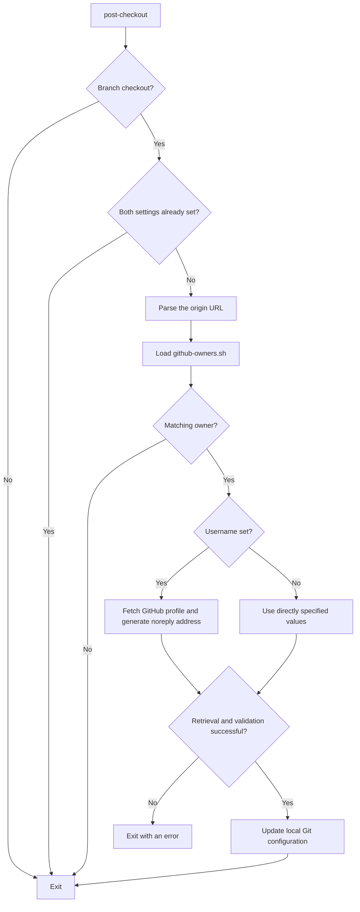

# GitHub Identity Auto Configuration

A `post-checkout` hook that automatically configures the Git commit identity based on the GitHub repository owner.
The hook updates only the repository's local Git configuration. No setup in `~/.gitconfig` is required.

## Features

- Selects an account based on the GitHub owner of `origin`
- Fetches the profile name from the GitHub REST API and generates a noreply email address
- Supports setting `user.name` and `user.email` directly
- Skips repositories with a configured identity, unmapped owners, and non-GitHub remotes
- Runs without a GitHub API token and makes no API requests in direct mode

## Requirements

Both modes require `bash`, `git`, `tr`, and `dirname`.
GitHub API mode also requires `curl`, `jq`, and an internet connection.

```bash
# macOS (if Git and curl are already available)
brew install jq

# Debian / Ubuntu
sudo apt install git curl jq

# Arch Linux
sudo pacman -S git curl jq
```

## Directory Structure

```text
git-hooks/
├── hooks/
│   ├── post-checkout       # hook script
│   └── github-owners.sh    # owner mappings
└── README.md
```

## Mapping Configuration

Edit the `case "$1"` statement in `map_github_owner()` in `hooks/github-owners.sh`. Use lowercase owner names.
`post-checkout` uses `source` to load `github-owners.sh` from its own directory, regardless of the repository's working directory.
The mapping file can be read without execute permission.
Replace the sample owners, usernames, names, and email addresses with your own values.

```bash
map_github_owner() {
    case "$1" in
        personal-user|side-project)
            username="personal-user"
            ;;
        company-org)
            username="work-user"
            ;;
        company-internal)
            name="Company Developer"
            email="developer@example.com"
            ;;
        client-org)
            name="Taro Yamada"
            email="taro@example.com"
            ;;
        *)
            return 1
            ;;
    esac
}
```

| Owner | Mode | Identity |
| --- | --- | --- |
| personal-user / side-project | GitHub API | Profile information for personal-user |
| company-org | GitHub API | Profile information for work-user |
| company-internal | Direct | Company Developer / developer@example.com |
| client-org | Direct | Taro Yamada / taro@example.com |
| Any other owner | Skip | No change |

### GitHub API Mode

Set only `username`. The hook makes an unauthenticated GitHub REST API request to `GET https://api.github.com/users/{username}` to retrieve `name`. If the profile name is unset, the hook uses `login`.

The hook generates `user.email` from the API's `id` and `login` in the form `{id}+{login}@users.noreply.github.com`. It ignores the public email address. If your account requires a different noreply format, as some older accounts do, check the address in your GitHub settings and use direct mode.

### Direct Mode

Set both `name` and `email` and leave `username` unset.

```bash
company-org)
    name="Taro Yamada"
    email="taro@example.com"
    ;;
```

The hook writes the supplied values directly to `user.name` and `user.email`. This mode works without GitHub API access, `curl`, or `jq`. It does not verify email address ownership or whether the address is registered with GitHub.

The hook reports an error if `username` is set alongside `name` or `email`, or if either value is missing in direct mode.

## Installation

### Install the Hook

Run these commands from the project root.

```bash
mkdir -p "$HOME/.config/git/hooks"
cp hooks/post-checkout hooks/github-owners.sh "$HOME/.config/git/hooks/"
chmod +x "$HOME/.config/git/hooks/post-checkout"
```

Place the mapping file in the same directory as the hook.
If you have already customized the mapping, preserve your copy when running the commands above.
After installation, edit the mapping in `$HOME/.config/git/hooks/github-owners.sh`.
Use only trusted mapping files because `source` executes Bash code.

### Enable for an Existing Repository

Run this command inside the target repository.

```bash
git config --local core.hooksPath "$HOME/.config/git/hooks"
```

If the repository already has a `core.hooksPath` setting or hooks, integrate the new hook into the existing directory or script to keep the other hooks active.

### Enable When Cloning a Repository

```bash
git clone \
    -c core.hooksPath="$HOME/.config/git/hooks" \
    git@github.com:company-org/example.git
```

### Automatic Installation with GIT_TEMPLATE_DIR

To install the hook in all new repositories, add it to a Git template.

```bash
mkdir -p "$HOME/.config/git/template/hooks"
cp "$HOME/.config/git/hooks/post-checkout" \
   "$HOME/.config/git/hooks/github-owners.sh" \
   "$HOME/.config/git/template/hooks/"
chmod +x "$HOME/.config/git/template/hooks/post-checkout"
```

Add the following line to `~/.bashrc` or `~/.zshrc` and restart your shell.

```bash
export GIT_TEMPLATE_DIR="$HOME/.config/git/template"
```

After that, a regular `git clone` installs the hook. The template copies both the hook script and the mapping file, so later changes to the template do not propagate to existing repositories. If `core.hooksPath` points to another directory, that directory takes precedence. For centralized management, set `core.hooksPath` in each repository's local Git configuration.

## Supported Remote URLs

The hook checks only the `origin` remote.

```text
git@github.com:owner/repository.git
https://github.com/owner/repository.git
ssh://git@github.com/owner/repository.git
ssh://git@github.com:22/owner/repository.git
ssh://git@ssh.github.com:443/owner/repository.git
```

The hook skips GitHub Enterprise Server, custom SSH host aliases, HTTPS URLs containing credentials, and URL formats outside the list above. It also skips repositories with an unmapped owner or no `origin` remote.

## Workflow



## Behavior

| Operation | Hook behavior |
| --- | --- |
| git clone | Runs if a checkout occurs |
| git checkout main | Runs |
| git switch main | Runs |
| git worktree add | Runs if a checkout occurs |
| git checkout -- file.txt | Skips |
| git commit / push / fetch | Does not run |

This behavior assumes the hook is enabled.

### Existing Identity Settings

| user.name | user.email | Hook behavior |
| --- | --- | --- |
| Set | Set | Skips |
| Set | Unset | Sets both |
| Unset | Set | Sets both |
| Unset | Unset | Sets both |

The hook treats empty values as unset. If only one setting is already set, the hook overwrites it so that the name and email address come from the same mapping. The check considers only local settings.

### Configuration Location

The hook writes the values to the repository's local Git configuration. This is an example of what direct mode writes.

```ini
[user]
    name = Company Developer
    email = developer@example.com
```

## Example Runs

```bash
git clone -c core.hooksPath="$HOME/.config/git/hooks" \
    git@github.com:company-internal/example.git
```

Example output in direct mode

```text
[post-checkout] company-internal (direct)
  user.name  = Company Developer
  user.email = developer@example.com
```

Example output in GitHub API mode

```text
[post-checkout] company-org (github-api)
  user.name  = Work User
  user.email = 12345678+work-user@users.noreply.github.com
```

## Run and Verify Manually

Run these commands inside the target repository.

```bash
"$HOME/.config/git/hooks/post-checkout" HEAD HEAD 1

git config --local --get user.name
git config --local --get user.email
git var GIT_AUTHOR_IDENT
git var GIT_COMMITTER_IDENT
```

To run the hook copied from a template directly, use the following command.

```bash
"$(git rev-parse --git-path hooks/post-checkout)" HEAD HEAD 1
```

## Reconfiguration

Mapping changes do not automatically apply to repositories with a configured identity. Remove the existing settings in the target repository and rerun the hook.

```bash
git config --local --unset-all user.name || true
git config --local --unset-all user.email || true
"$HOME/.config/git/hooks/post-checkout" HEAD HEAD 1
```

Verify that the new mapping is valid before removing the existing identity settings. If you installed the hook using a template, also update the copied mapping file.

## Uninstallation

If you use `core.hooksPath`, run the following command in the target repository. If there was a previous value, restore it.

```bash
git config --local --unset-all core.hooksPath
```

If you use a template, run the following command.

```bash
rm -f "$HOME/.config/git/template/hooks/post-checkout" \
      "$HOME/.config/git/template/hooks/github-owners.sh"
```

Before deleting the copied files from a target repository, verify that they belong to this project.

```bash
rm -f "$(git rev-parse --git-path hooks/post-checkout)" \
      "$(git rev-parse --git-path hooks/github-owners.sh)"
```

Removing the hook preserves the configured `user.name` and `user.email` values.

## Error Handling and Notes

- The hook exits with an error if the mapping file is missing, fails to load, or lacks the mapping function. It skips repositories with a configured identity or an unsupported remote before loading the file.
- The hook exits with an error if it cannot fetch the API response, validate the response or configuration values, or write to the Git configuration.
- The API connection timeout is 5 seconds, and the overall request timeout is 15 seconds. Unauthenticated API requests are subject to rate limits.
- A completed checkout stays in effect if the hook exits with an error.
- The hook leaves your GitHub authentication account, SSH keys, commit signing, and existing commit metadata untouched.
- If you install the hook as a symbolic link, place the mapping file in the directory from which the hook is invoked, alongside the link.
- To associate an email address set in direct mode with a GitHub account, use an address that the account can use.
- Worktrees normally share the repository's local Git configuration. The hook does not manage overrides from environment variables or worktree-specific settings.
- The hook writes `user.name` and `user.email` separately, so the two updates are not atomic.
