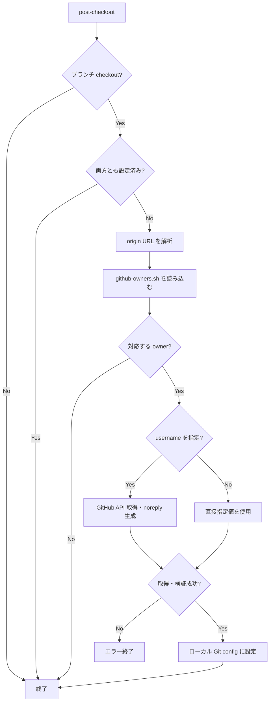

# GitHub Identity Auto Configuration

GitHub リポジトリの owner に基づき、Git のコミットユーザー情報を自動設定する `post-checkout` hook。
`~/.gitconfig` への設定は不要。リポジトリのローカル Git config のみを更新する。

## 特徴

- `origin` の GitHub owner に基づくアカウントの選択
- GitHub REST API によるプロフィール名の取得と noreply アドレスの生成
- `user.name` と `user.email` の直接指定
- 設定済みリポジトリ、未登録 owner、GitHub 以外の remote のスキップ
- GitHub API トークン不要、直接指定モードでは API 通信不要

## 必要な環境

共通: `bash`、`git`、`tr`、`dirname`。
GitHub API モードのみ: `curl`、`jq`、インターネット接続。

```bash
# macOS（Git と curl が利用できる場合）
brew install jq

# Debian / Ubuntu
sudo apt install git curl jq

# Arch Linux
sudo pacman -S git curl jq
```

## ディレクトリ構成

```text
git-hooks/
├── hooks/
│   ├── post-checkout       # hook 本体
│   └── github-owners.sh    # owner マッピング
└── README.md
```

## マッピング設定

`hooks/github-owners.sh` の `map_github_owner()` 内の `case "$1"` を編集する。owner は小文字で指定する。
`post-checkout` は自分と同じディレクトリにある `github-owners.sh` を `source` で読み込むため、
リポジトリの作業ディレクトリに依存しない。マッピングファイル自体に実行権限は不要。
サンプルの owner、username、名前、メールアドレスは実際に使用する値へ置き換えること。

```bash
map_github_owner() {
    case "$1" in
        personal-user|side-project)
            username="personal-user"
            ;;
        company-org)
            username="work-user"
            ;;
        company-internal)
            name="Company Developer"
            email="developer@example.com"
            ;;
        client-org)
            name="Taro Yamada"
            email="taro@example.com"
            ;;
        *)
            return 1
            ;;
    esac
}
```

| Owner | モード | 設定内容 |
| --- | --- | --- |
| personal-user / side-project | GitHub API | personal-user のプロフィール情報 |
| company-org | GitHub API | work-user のプロフィール情報 |
| company-internal | 直接指定 | Company Developer / developer@example.com |
| client-org | 直接指定 | Taro Yamada / taro@example.com |
| その他 | スキップ | 変更しない |

### GitHub API モード

`username` のみを指定する。GitHub REST API の `GET https://api.github.com/users/{username}` を未認証で呼び出し、`name` を取得する。プロフィール名が未設定の場合は `login` を使用する。

`user.email` は API の `id` と `login` から `{id}+{login}@users.noreply.github.com` 形式で生成する。公開メールアドレスは使用しない。古いアカウントなどで別の noreply 形式が必要な場合は、GitHub の設定で確認のうえ直接指定モードを使用する。

### 直接指定モード

`name` と `email` の両方を指定する。`username` は指定しない。

```bash
company-org)
    name="Taro Yamada"
    email="taro@example.com"
    ;;
```

指定値をそのまま `user.name` と `user.email` に設定する。GitHub API への通信はなく、`curl`、`jq` も不要。メールアドレスの所有権や GitHub での登録状態は検証しない。

`username` と `name` / `email` の混在、直接指定値の不足はエラーとする。

## インストール

### hook の配置

プロジェクトのルートで実行する。

```bash
mkdir -p "$HOME/.config/git/hooks"
cp hooks/post-checkout hooks/github-owners.sh "$HOME/.config/git/hooks/"
chmod +x "$HOME/.config/git/hooks/post-checkout"
```

マッピングファイルは hook と同じディレクトリに配置すること。
すでにマッピングをカスタマイズしている場合は、上記のコピーで上書きしないよう注意する。
以降、マッピングの編集は `$HOME/.config/git/hooks/github-owners.sh` のみでよい。
`source` は Bash コードを実行するため、信頼できるマッピングファイルのみを使用する。

### 既存リポジトリへの適用

対象リポジトリ内で実行する。

```bash
git config --local core.hooksPath "$HOME/.config/git/hooks"
```

既存の `core.hooksPath` や hook がある場合は、他の hook を無効化しないよう既存のディレクトリ・スクリプトに統合すること。

### 新規リポジトリへの適用

```bash
git clone \
    -c core.hooksPath="$HOME/.config/git/hooks" \
    git@github.com:company-org/example.git
```

### GIT_TEMPLATE_DIR による自動配布

すべての新規リポジトリに適用したい場合は、テンプレートに hook を配置する。

```bash
mkdir -p "$HOME/.config/git/template/hooks"
cp "$HOME/.config/git/hooks/post-checkout" \
   "$HOME/.config/git/hooks/github-owners.sh" \
   "$HOME/.config/git/template/hooks/"
chmod +x "$HOME/.config/git/template/hooks/post-checkout"
```

`~/.bashrc` または `~/.zshrc` に以下を追加し、シェルを再起動する。

```bash
export GIT_TEMPLATE_DIR="$HOME/.config/git/template"
```

以降は通常の `git clone` で hook が配布される。テンプレートは hook 本体とマッピングファイルの両方をコピーする方式のため、変更は既存リポジトリへ自動反映されない。`core.hooksPath` が別のディレクトリに設定されている場合はそちらが優先される。一元管理したい場合はローカルの `core.hooksPath` を使用する。

## 対応する Remote URL

対象 remote は `origin` のみ。

```text
git@github.com:owner/repository.git
https://github.com/owner/repository.git
ssh://git@github.com/owner/repository.git
ssh://git@github.com:22/owner/repository.git
ssh://git@ssh.github.com:443/owner/repository.git
```

GitHub Enterprise Server、SSH の独自 Host エイリアス、認証情報付き HTTPS URL、上記以外の形式は未対応。マッピング未登録の owner や `origin` が存在しない場合も何も変更しない。

## 動作フロー



## 動作仕様

| 操作 | 動作 |
| --- | --- |
| git clone | 実行（checkout がある場合） |
| git checkout main | 実行 |
| git switch main | 実行 |
| git worktree add | 実行（checkout がある場合） |
| git checkout -- file.txt | スキップ |
| git commit / push / fetch | 実行しない |

hook が有効化されていることが前提。

### 設定済みリポジトリ

| user.name | user.email | 動作 |
| --- | --- | --- |
| 設定済み | 設定済み | スキップ |
| 設定済み | 未設定 | 両方を設定 |
| 未設定 | 設定済み | 両方を設定 |
| 未設定 | 未設定 | 両方を設定 |

空文字列は未設定と扱う。片方だけ設定済みの場合は名前とメールアドレスの組み合わせを統一するため、設定済みの値も上書きする。グローバル設定は判定に使用しない。

### 設定先

リポジトリのローカル Git config に設定する。例えば直接指定モードでは次のようになる。

```ini
[user]
    name = Company Developer
    email = developer@example.com
```

## 実行例

```bash
git clone -c core.hooksPath="$HOME/.config/git/hooks" \
    git@github.com:company-internal/example.git
```

出力例:

```text
[post-checkout] company-internal (direct)
  user.name  = Company Developer
  user.email = developer@example.com
```

GitHub API モードの場合の出力例:

```text
[post-checkout] company-org (github-api)
  user.name  = Work User
  user.email = 12345678+work-user@users.noreply.github.com
```

## 手動実行と確認

対象リポジトリ内で実行する。

```bash
"$HOME/.config/git/hooks/post-checkout" HEAD HEAD 1

git config --local --get user.name
git config --local --get user.email
git var GIT_AUTHOR_IDENT
git var GIT_COMMITTER_IDENT
```

テンプレートでコピーした hook を直接使用する場合は、以下で実行する。

```bash
"$(git rev-parse --git-path hooks/post-checkout)" HEAD HEAD 1
```

## 再設定

マッピングを変更しても設定済みのリポジトリには自動反映されない。対象リポジトリで既存設定を削除したうえで再実行する。

```bash
git config --local --unset-all user.name || true
git config --local --unset-all user.email || true
"$HOME/.config/git/hooks/post-checkout" HEAD HEAD 1
```

この操作は既存のユーザー設定を削除するため、新しいマッピングが有効であることを事前に確認する。テンプレート方式の場合は、コピー済みのマッピングファイルも更新すること。

## アンインストール

`core.hooksPath` を使用している場合は、対象リポジトリで以下を実行する（以前の値がある場合は復元する）。

```bash
git config --local --unset-all core.hooksPath
```

テンプレート方式の場合は以下を実行する。

```bash
rm -f "$HOME/.config/git/template/hooks/post-checkout" \
      "$HOME/.config/git/template/hooks/github-owners.sh"
```

コピー済みの hook は、対象リポジトリで本プロジェクトのファイルであることを確認してから削除する。

```bash
rm -f "$(git rev-parse --git-path hooks/post-checkout)" \
      "$(git rev-parse --git-path hooks/github-owners.sh)"
```

hook を削除しても設定済みの `user.name` と `user.email` は維持される。

## エラーハンドリングと注意事項

- マッピングファイルの欠落・読み込み失敗・マッピング関数の欠落時はエラー終了する（設定済みリポジトリや対象外 remote は読み込み前にスキップする）。
- API 取得・レスポンス検証・設定値の検証・Git config 書き込み失敗時はエラー終了する。
- API の接続タイムアウトは 5 秒、リクエスト全体は 15 秒。未認証 API にはレート制限がある。
- hook が異常終了しても、完了済みの checkout は取り消されない。
- GitHub の認証アカウント、SSH 鍵、コミット署名、既存コミットの情報は変更しない。
- hook をシンボリックリンクで配置する場合も、マッピングファイルは hook の呼び出しパスと同じディレクトリに配置する。
- 直接指定したメールアドレスを GitHub アカウントへ紐づけたい場合は、そのアカウントで利用可能なアドレスを指定する。
- worktree 間では通常ローカル Git config が共有される。環境変数や worktree 固有設定による上書きは管理対象外。
- `user.name` と `user.email` の書き込みはアトミックではない。
