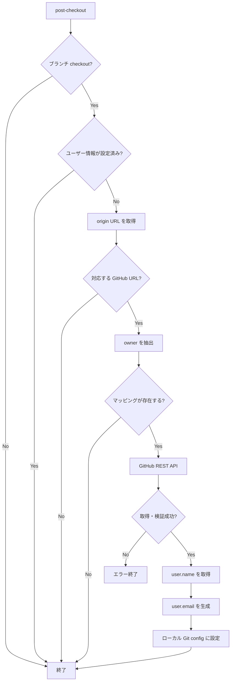

# GitHub Identity Auto Configuration

GitHub リポジトリの owner に応じて、Git のコミットユーザー情報を
自動設定する `post-checkout` hook。

GitHub REST API を利用してユーザー情報を取得し、
リポジトリのローカル Git config に `user.name` と
`user.email` を設定する。

`~/.gitconfig` への設定は不要。

## 特徴

- GitHub owner に基づくアカウントの自動選択
- 複数の GitHub アカウントに対応
- GitHub REST API によるユーザー情報の取得
- GitHub noreply メールアドレスの自動生成
- リポジトリ単位でのユーザー情報管理
- 設定済みリポジトリのスキップ
- GitHub 以外のリポジトリへの影響なし
- グローバル Git config への依存なし
- GitHub API トークン不要

## 必要な環境

以下のコマンドが利用可能であること。

- bash
- git
- curl
- jq
- tr

### macOS

```bash
brew install jq
```

### Debian / Ubuntu

```bash
sudo apt install git curl jq
```

### Arch Linux

```bash
sudo pacman -S git curl jq
```

## ディレクトリ構成

```text
git-hooks/
├── hooks/
│   └── post-checkout
└── README.md
```

## マッピング設定

`hooks/post-checkout` 内の `case "$owner"` を編集する。

```bash
case "$owner" in
    personal-user|side-project)
        username="personal-user"
        ;;
    company-org|company-dev)
        username="work-user"
        ;;
    *)
        exit 0
        ;;
esac
```

左辺に GitHub のユーザー名または Organization 名を指定し、
右辺の `username` にコミットで使用する GitHub ユーザー名を指定する。

複数の owner を同じ GitHub ユーザーにマッピングできる。

| GitHub owner | GitHub username |
| --- | --- |
| personal-user | personal-user |
| side-project | personal-user |
| company-org | work-user |
| company-dev | work-user |

owner は小文字に正規化されるため、
マッピングには小文字で指定すること。

未登録の owner は処理対象外となる。

## インストール

### hook の配置

```bash
mkdir -p "$HOME/.config/git/hooks"

cp hooks/post-checkout \
    "$HOME/.config/git/hooks/post-checkout"

chmod +x "$HOME/.config/git/hooks/post-checkout"
```

### 既存リポジトリへの適用

対象リポジトリ内で以下を実行する。

```bash
git config --local core.hooksPath \
    "$HOME/.config/git/hooks"
```

以降、ブランチの checkout や switch 時に hook が実行される。

既存の hook がある場合は、上書きや無効化を避けるため、
既存の hook ディレクトリに統合すること。

### 新規リポジトリへの適用

clone 時に `core.hooksPath` を指定する。

```bash
git clone \
    -c core.hooksPath="$HOME/.config/git/hooks" \
    git@github.com:company-org/example.git
```

clone 時の checkout から hook が実行される。

### GIT_TEMPLATE_DIR による自動配布

すべての新規リポジトリに hook を自動配布する場合は、
`GIT_TEMPLATE_DIR` を利用する。

```bash
mkdir -p "$HOME/.config/git/template/hooks"

cp "$HOME/.config/git/hooks/post-checkout" \
    "$HOME/.config/git/template/hooks/post-checkout"

chmod +x "$HOME/.config/git/template/hooks/post-checkout"
```

使用しているシェルの設定ファイルに以下を追加する。

- Bash: `~/.bashrc`
- Zsh: `~/.zshrc`

```bash
export GIT_TEMPLATE_DIR="$HOME/.config/git/template"
```

シェルの設定を再読み込みする。

```bash
# Bash
source ~/.bashrc

# Zsh
source ~/.zshrc
```

以降は通常どおり clone するだけで hook が適用される。

```bash
git clone git@github.com:company-org/example.git
```

`GIT_TEMPLATE_DIR` は hook を各リポジトリにコピーする方式である。
hook を更新しても既存リポジトリには自動反映されない。

一元管理する場合は `core.hooksPath` を使用すること。

## 対応する Remote URL

以下の GitHub remote URL に対応する。

```text
git@github.com:owner/repository.git
https://github.com/owner/repository.git
ssh://git@github.com/owner/repository.git
ssh://git@github.com:22/owner/repository.git
ssh://git@ssh.github.com:443/owner/repository.git
```

取得対象の remote は `origin` とする。

以下は処理対象外となる。

- GitHub 以外のホスティングサービス
- GitHub Enterprise Server
- SSH の独自 Host エイリアス
- origin が存在しないリポジトリ
- マッピング未登録の owner

## 動作フロー



## 動作仕様

### hook の実行条件

| 操作 | 動作 |
| --- | --- |
| git clone | 実行 |
| git checkout main | 実行 |
| git switch main | 実行 |
| git worktree add | 実行 |
| git checkout -- file.txt | スキップ |
| git commit | 実行しない |
| git push | 実行しない |
| git fetch | 実行しない |

hook が有効化されており、checkout が行われることを前提とする。

### 設定済みリポジトリ

`user.name` と `user.email` が両方ともローカル設定済みの場合、
処理をスキップする。

| user.name | user.email | 動作 |
| --- | --- | --- |
| 設定済み | 設定済み | スキップ |
| 設定済み | 未設定 | 両方設定 |
| 未設定 | 設定済み | 両方設定 |
| 未設定 | 未設定 | 両方設定 |

空文字列は未設定として扱う。

片方のみ設定されている場合は、
名前とメールアドレスの整合性を維持するため両方を上書きする。

設定済みの場合は GitHub API への通信も行わない。

### GitHub REST API

以下のエンドポイントを使用する。

```text
GET https://api.github.com/users/{username}
```

レスポンスから以下のフィールドを取得する。

| フィールド | 用途 |
| --- | --- |
| id | noreply メールアドレスの生成 |
| login | GitHub ユーザー名 |
| name | プロフィール名 |
| type | ユーザー種別の検証 |

プロフィール名が未設定の場合は `login` を使用する。

### メールアドレス

以下の形式で GitHub noreply メールアドレスを生成する。

```text
{id}+{login}@users.noreply.github.com
```

例：

```text
12345678+work-user@users.noreply.github.com
```

GitHub API が返す公開メールアドレスは使用しない。

古い GitHub アカウントでは noreply メールアドレスの形式が
異なる場合があるため、必要に応じて GitHub の設定画面で確認する。

### 設定先

リポジトリのローカル Git config に設定する。

```ini
[user]
    name = Work User
    email = 12345678+work-user@users.noreply.github.com
```

グローバル Git config は変更しない。

## 実行例

```bash
git clone git@github.com:company-org/example.git
```

出力例：

```text
[post-checkout] company-org -> work-user
  user.name  = Work User
  user.email = 12345678+work-user@users.noreply.github.com
```

## 手動実行

checkout を行わずに hook を実行する場合は、
対象リポジトリ内で以下を実行する。

```bash
"$HOME/.config/git/hooks/post-checkout" HEAD HEAD 1
```

## 設定の確認

ローカル Git config を確認する。

```bash
git config --local --get user.name
git config --local --get user.email
```

実際に使用されるコミットユーザー情報を確認する。

```bash
git var GIT_AUTHOR_IDENT
git var GIT_COMMITTER_IDENT
```

hook の設定先を確認する。

```bash
git config --local --get core.hooksPath
```

## ユーザー情報の再設定

設定済みのユーザー情報を変更する場合は、
ローカル設定を削除して hook を再実行する。

```bash
git config --local --unset-all user.name || true
git config --local --unset-all user.email || true

"$HOME/.config/git/hooks/post-checkout" HEAD HEAD 1
```

マッピングや remote URL を変更した場合も、
設定済みのユーザー情報は自動更新されない。

## アンインストール

### core.hooksPath を使用している場合

対象リポジトリ内で以下を実行する。

```bash
git config --local --unset-all core.hooksPath
```

### GIT_TEMPLATE_DIR を使用している場合

テンプレート内の hook を削除する。

```bash
rm -f "$HOME/.config/git/template/hooks/post-checkout"
```

既存リポジトリにコピー済みの hook は個別に削除する。

```bash
rm -f "$(git rev-parse --git-path hooks/post-checkout)"
```

削除前に対象ファイルが本プロジェクトの hook であることを確認する。

hook を削除しても設定済みの `user.name` と
`user.email` は維持される。

## エラーハンドリング

以下の場合はエラーを出力して異常終了する。

- 必要なコマンドが存在しない
- GitHub username が不正
- GitHub API への通信に失敗
- GitHub API のレスポンスが不正
- ローカル Git config への書き込みに失敗

通信タイムアウトは以下のとおり。

| 項目 | タイムアウト |
| --- | --- |
| 接続 | 5 秒 |
| リクエスト全体 | 15 秒 |

post-checkout hook が異常終了した場合でも、
完了済みの checkout は取り消されない。

## 注意事項

- GitHub API の未認証リクエストにはレート制限がある。
- API から取得する情報は公開プロフィール情報のみ。
- GitHub の認証アカウントや SSH 鍵は変更しない。
- コミット署名や GPG 鍵の設定は変更しない。
- 過去のコミットのユーザー情報は変更しない。
- Git worktree 間では通常、ローカル Git config が共有される。
- ユーザー情報が設定済みの場合、remote の変更は反映されない。
- 環境変数や worktree 固有設定によるユーザー情報の上書きは
  本 hook の管理対象外とする。
- user.name と user.email の書き込みはアトミックではない。
